# Smart Pantry Manager

**Smart Food Inventory & Waste Reduction System** — a full-stack web app that tracks what's in your kitchen, warns you before food expires, tells you what to use first, and measures how much food (and money) gets wasted.

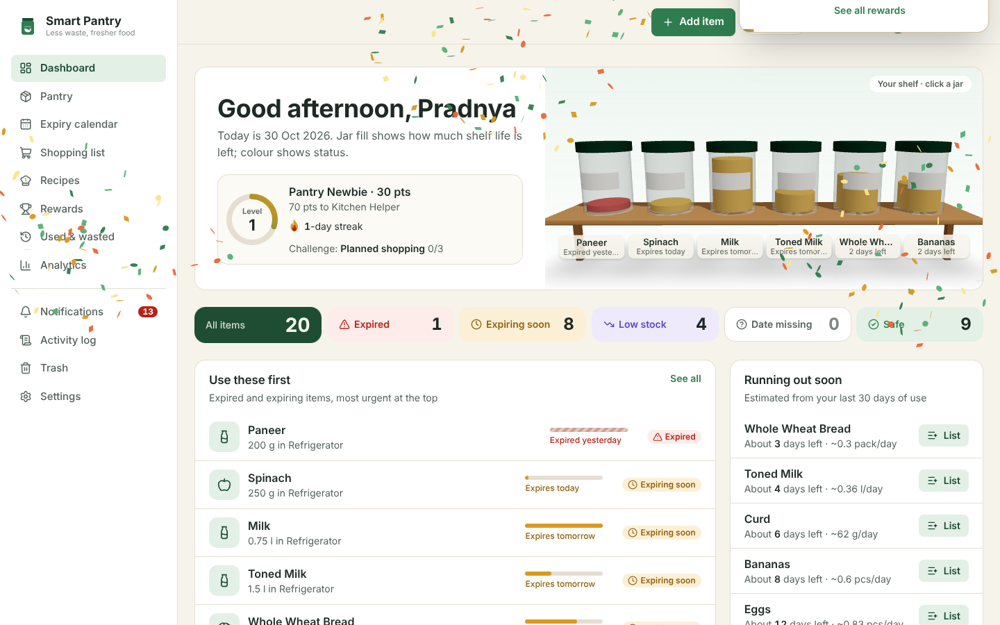

| Pantry list | Item with batches | Analytics |
|---|---|---|
| 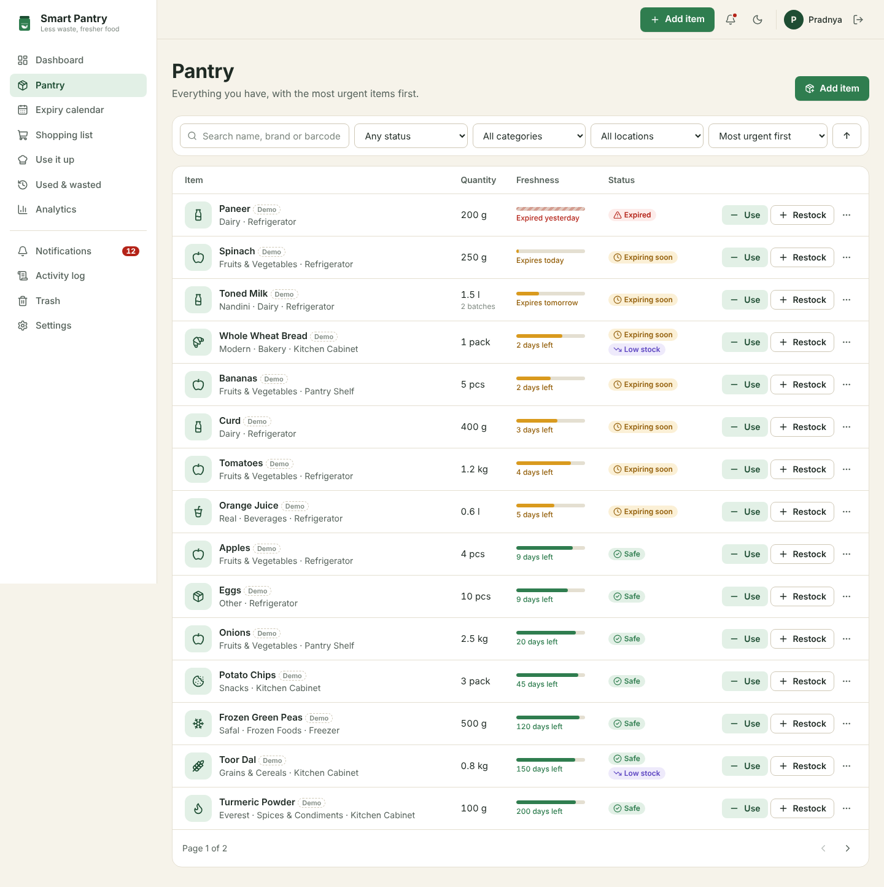 | 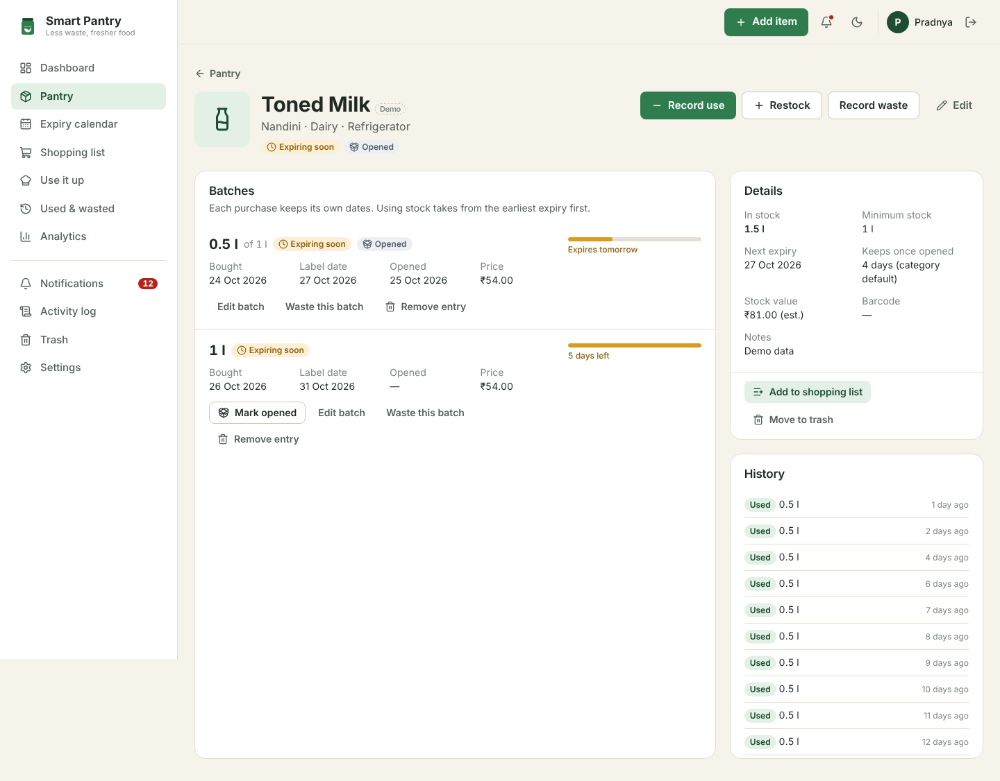 | 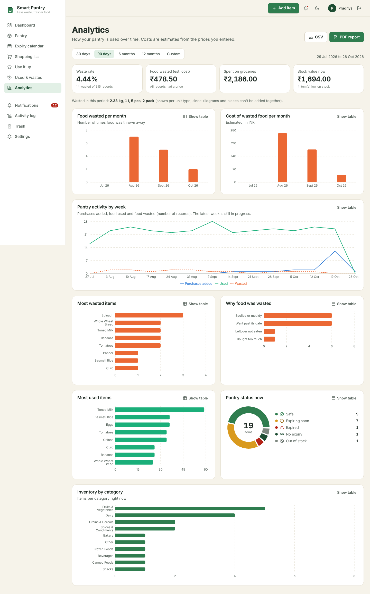 |

| 3D welcome page | Rewards & badges | Badge celebration |
|---|---|---|
| 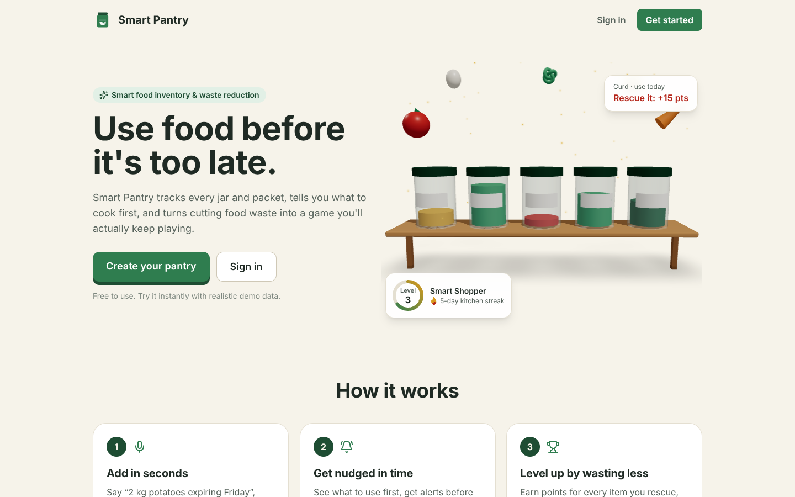 | 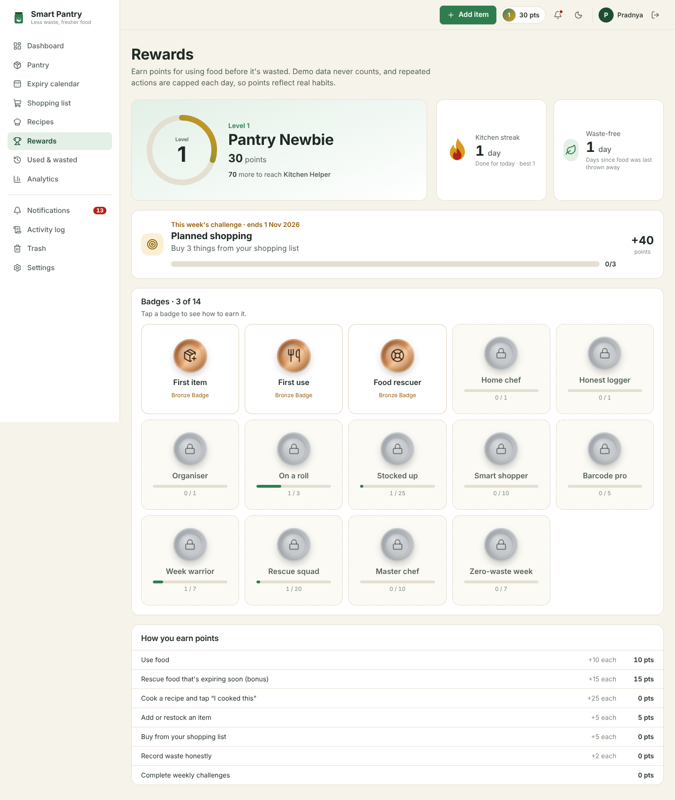 | 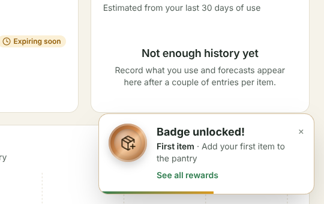 |

| Recipes by ingredient | Recipe with pantry check | Animated cook-along |
|---|---|---|
| 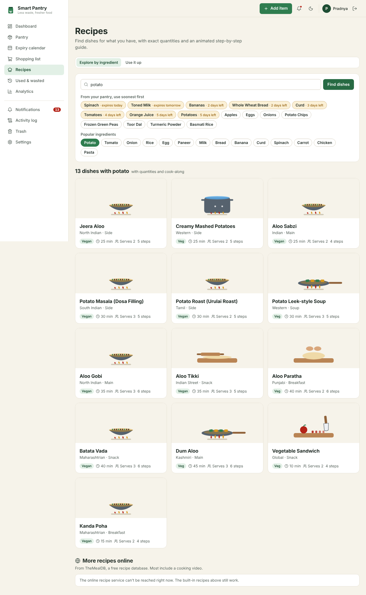 | 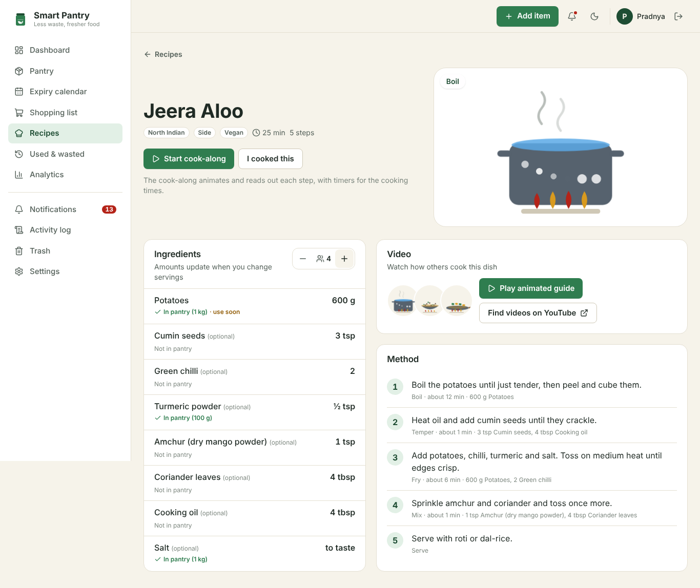 | 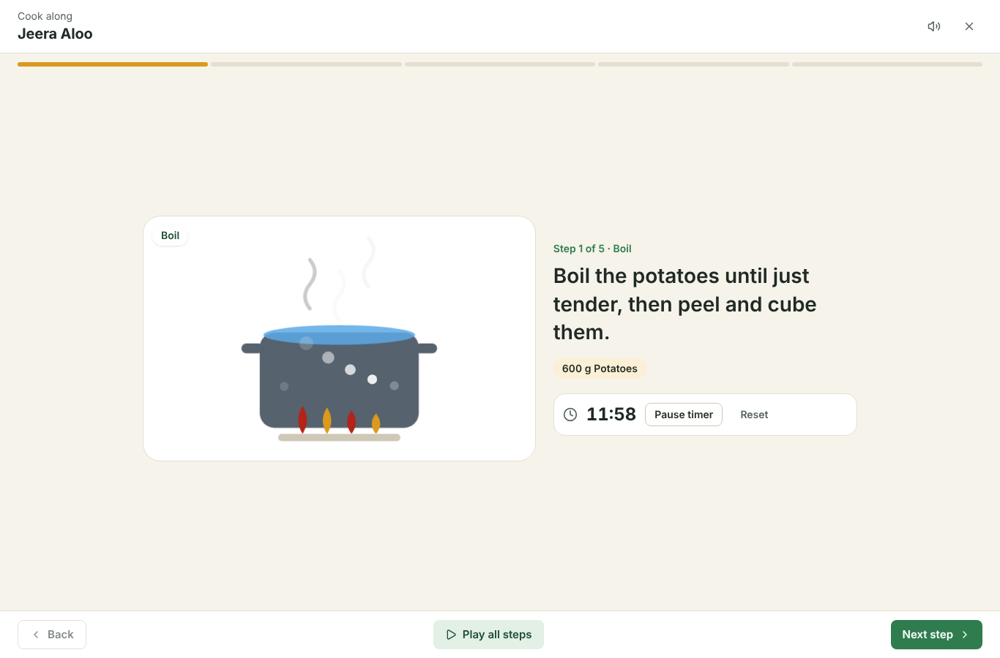 |

| Dark mode | Mobile | Sign in |
|---|---|---|
| 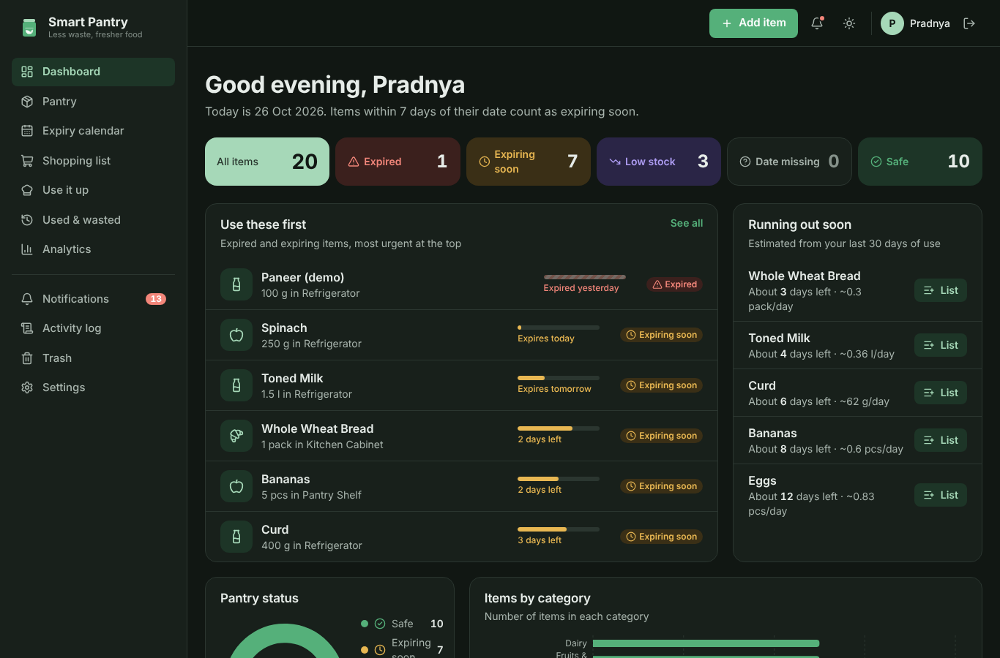 | 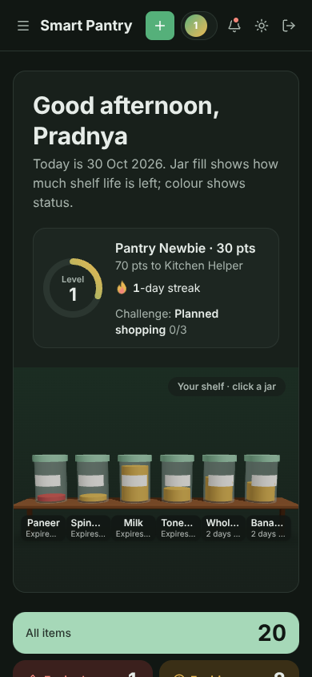 | 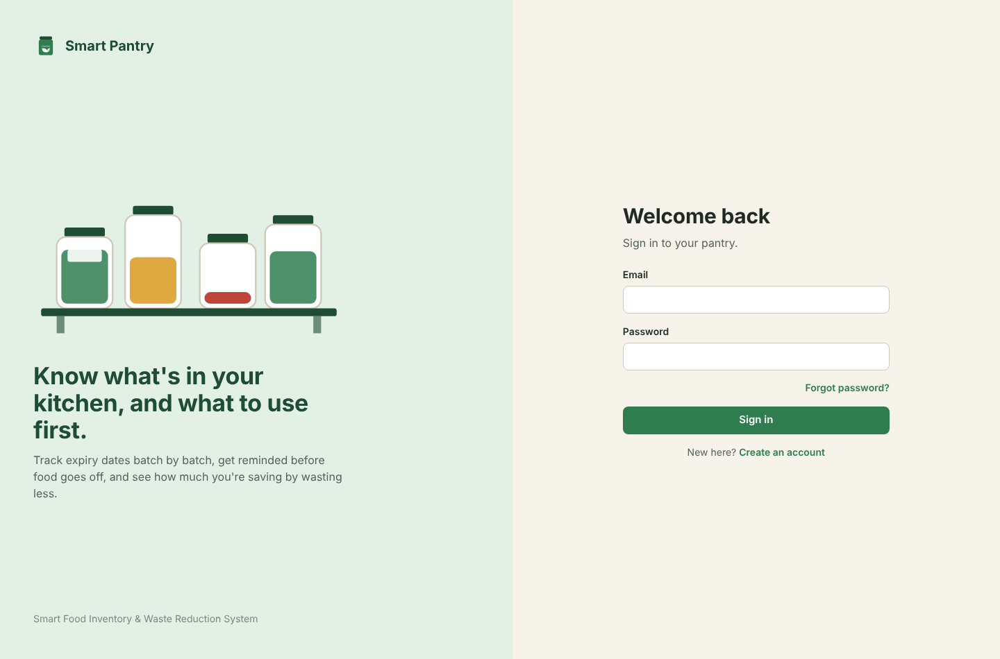 |

---

## Demo video and presentation

- **[Working demo video (1:46)](docs/presentation/Smart_Pantry_Demo.mp4)** — a captioned walkthrough of the running app, from sign-up to rewards
- **[Project presentation (PowerPoint, 16 slides)](docs/presentation/Smart_Pantry_Manager_Presentation.pptx)** — problem, features, architecture, testing and results, with speaker notes

## What it does

### Core (all requirements)
- **Dashboard** with live counts (expired, expiring soon, low stock, date missing, safe), a status doughnut, items by category, recent activity and quick actions — every number is computed from the database, nothing is hard-coded.
- **Pantry CRUD**: add, view, edit, delete (to Trash with **Undo**), search by name/brand/barcode, filter by status/category/location, sort by urgency/expiry/name/quantity/purchase date, pagination.
- **Expiry monitoring**: Safe / Expiring soon / Expired with a configurable warning period (default 7 days), "days left" in plain words, sorting by urgency, and correct handling of time zones.
- **Low stock**: per-item minimum, alerts, restock, consumption tracking, and stock that can never go negative.
- **Categories & storage locations**: defaults plus custom ones; deleting one that's in use requires moving its items first.
- **Shopping list**: manual entries, "add all low-stock items", duplicate protection, and "Mark bought" which can put the purchase straight into the pantry (asking for its real expiry date).
- **Consumption & waste tracking** with reasons, full history, most-wasted items and monthly trends.
- **Notifications**: expiring, expired, low-stock and run-out alerts with read/unread state and history; optional daily email digest.
- **Analytics** with date ranges, CSV export and a **PDF report**.
- **Barcode** lookup (camera scan or typed) via Open Food Facts, plus **photo upload**.
- **Authentication**: register, sign in, sign out, password reset, change password; every API route checks ownership.
- **Import / export / backup**: CSV import with a preview of errors and duplicates, CSV exports, JSON backup and restore.
- **Activity log** of every change.

### 3D and gamification
| Feature | What it does |
|---|---|
| **3D pantry shelf** (dashboard) | Your real items as glass jars on a 3D shelf. Fill level is how much shelf life is left; colour is the status (red expired, amber expiring, green safe). The view follows the mouse, and clicking a jar opens the item. |
| **3D welcome page** | Visitors who aren't signed in see an interactive 3D scene (jars, floating produce, sparkles), animated headline and scroll-in sections. |
| **Points & levels** | Points for real habits: use food (+10), **rescue** food that's expiring soon (+15 bonus), cook a recipe (+25), add/restock (+5), shop from your list (+5), record waste honestly (+2). Seven levels from *Pantry Newbie* to *Pantry Legend*. |
| **Streaks** | A kitchen streak (days in a row you used food, with a flickering flame) and a waste-free streak. |
| **14 badges** | Bronze, silver and gold 3D medals that spin and flip over to show how they're earned. Locked ones show progress. |
| **Weekly challenge** | A new challenge every Monday (e.g. “Rescue 3 items that are expiring soon”) with bonus points. |
| **Celebrations** | “+25 pts” pops by the level chip; a confetti card with a spinning medal for new badges or a level-up. It sits in the corner and doesn't block the page. |
| **Fair play** | Demo data never earns points, and each action is capped per day, so points can't be farmed by adding and deleting items. |
| **Motion that respects people** | Number count-ups, cards that tilt towards the pointer, animated progress rings. With “reduce motion” turned on, everything stays but stops moving. Without WebGL, a flat 2D shelf is shown instead. The 3D engine (~250 KB compressed) loads only on pages that use it. |

### Extra features that make it stand out
| Feature | Why it matters |
|---|---|
| **Batches with FEFO** (First-Expiry-First-Out) | Two packs of milk bought on different days keep their own dates. Using stock always takes the one expiring first — how real inventory systems work. |
| **"Opened" shelf life** | Mark a jar as opened and its effective expiry becomes the earlier of the label date and opened date + N days (defaults per category, overridable per item). |
| **Freshness meter** | Every item shows how much of its shelf life is left, from purchase to expiry. |
| **Run-out forecast** | Average daily use over the last 30 days → "about 4 days left". Explainable, labelled as an estimate. |
| **Recipes by ingredient** | Type "potato" (or "aloo") and see every dish you can make: 13 potato dishes in the built-in library of 39 recipes, plus online recipes from TheMealDB with their cooking videos. Dishes named after the ingredient come first. |
| **Exact quantities that scale** | Choose servings and every amount updates (300 g → 600 g). Each ingredient shows whether your pantry has enough, and missing ones go to the shopping list in one click. |
| **Animated cook-along** | A step-by-step player with an animation for each cooking action (boil, chop, knead, roll, fry… 17 in all). "Play all steps" narrates each step aloud and moves on by itself, like a video. Real kitchen timers beep when time's up. Works offline, on phones, and with the keyboard. |
| **"I cooked this"** | After cooking, confirm what you used and the pantry is updated (oldest stock first). |
| **"Use it up" recipes** | Rule-based suggestions ranked by how many *expiring* items a recipe uses. Never suggests expired food. |
| **Expiry calendar** | Month view of when food in stock reaches its date. |
| **Expired-food safeguard** | Recording use of expired stock asks for confirmation first, offering to record it as waste. |
| **Quick add by voice or text** | Type or say “2 kg potatoes expiring Friday” and the Add Item form fills itself in: name, quantity, unit, expiry date, and a guessed category and storage place. Understands “tomorrow”, weekdays, “in 4 days”, “10 November” and “5/11”. The microphone works in Chrome, Edge and Safari; typing works everywhere. |
| **Unit conversion** | Use 250 g from a 1 kg item; incompatible units (kg vs pieces) are rejected. |
| **Demo mode** | One click loads 19 realistic items with 3 months of history; one click removes only demo data. |
| **Family sharing** | Create a household and share an 8-letter invite code (or a link on WhatsApp). Everyone works on one pantry, shopping list and alerts from their own phone. Members are *Can edit* or *View only*; the activity log shows who did what ("by Asha"). Leaving brings your own pantry back untouched. |
| **Phone notifications** | Turn on notifications per device (Android, desktop, and iPhone once added to the Home Screen). A daily summary of new alerts reaches every device of everyone in the household, even with the app closed. Tapping it opens the Notifications page. |
| **English · हिन्दी · ಕನ್ನಡ** | Switch language anywhere (header, sign-in page). The whole interface changes instantly, is remembered per device, and item names you typed stay exactly as entered. |
| **Promo video** | A 30-second tour of the app (3D shelf, quick add, cook-along, rewards, languages) plays on the welcome page. |
| **Dark mode, PWA, accessibility** | Installable app, keyboard-navigable dialogs, labelled controls, status shown with icon + text (never colour alone), every chart has a table view. |

---

## Tech stack

| Layer | Technology |
|---|---|
| Frontend | React 19 + Vite + TypeScript, Tailwind CSS v4, Recharts, TanStack Query, React Router |
| Backend | Node.js + Express 5 + TypeScript, Zod validation |
| Database | PostgreSQL 16 via Prisma ORM 7 |
| Auth | bcrypt password hashing, JWT in an httpOnly cookie, CSRF header check, rate limiting |
| Testing | Vitest + Supertest (API, real database), Playwright (browser, desktop + mobile) |
| DevOps | Docker Compose, GitHub Actions CI, Render (API) + Vercel (web) + Neon (database) |

---

## Run it locally

You need **Node.js 22** (or 20.19+). Pick **one** database option.

### Option A — Docker (one command, easiest)
Install [Docker Desktop](https://www.docker.com/products/docker-desktop/), then in the project folder:
```bash
docker compose up --build
```
Open **http://localhost:8080**. The database, API and website all start together; migrations run automatically.

### Option B — Without Docker (Windows, macOS or Linux)

**1. Get a PostgreSQL database** — either:
- **Neon (free, nothing to install):** create a project at [neon.tech](https://neon.tech), copy its connection string, or
- **Local install:** install PostgreSQL 16 and create a database called `smart_pantry`.

**2. Configure the API**
```bash
cd server
copy .env.example .env        # Windows (use "cp" on macOS/Linux)
```
Edit `server/.env`:
- `DATABASE_URL` — your connection string
- `JWT_SECRET` — any long random string. Generate one with:
  `node -e "console.log(require('crypto').randomBytes(48).toString('hex'))"`

**3. Install, create the tables, run**
```bash
cd ..                 # back to the project root
npm install           # installs the "run both" helper
npm run setup         # installs server + client
npm run db:migrate    # creates the database tables
npm run dev           # starts API (port 4000) + website (port 5173)
```
Open **http://localhost:5173**, create an account, and click **Try with demo data** to see everything working.

> Password reset without email: when SMTP isn't configured and you're not in production, the "Forgot password" page shows the reset link directly (clearly labelled as development mode). It is never shown in production.

### Environment variables (`server/.env`)
| Variable | Required | Purpose |
|---|---|---|
| `DATABASE_URL` | yes | PostgreSQL connection string |
| `JWT_SECRET` | yes | Signs login tokens (32+ characters in production) |
| `CLIENT_URL` | yes | Website address, used for CORS and reset links |
| `DEV_SHOW_RESET_LINK` | no | Local development only: shows reset links on screen when email isn't set up. Ignored in production; never set it on a deployed server |
| `PORT` | no | API port (default 4000) |
| `SMTP_HOST`, `SMTP_PORT`, `SMTP_USER`, `SMTP_PASS`, `SMTP_FROM` | no | Enables reset emails and daily reminder emails |
| `BARCODE_LOOKUP_ENABLED` | no | `false` turns off the Open Food Facts lookup |
| `ONLINE_RECIPES_ENABLED` | no | `false` turns off online recipes and videos (TheMealDB) |
| `REMINDER_CRON` | no | When the daily reminder job runs (default `0 8 * * *`) |
| `VAPID_PUBLIC_KEY`, `VAPID_PRIVATE_KEY`, `VAPID_SUBJECT` | no | Keys for phone notifications. Leave empty and the server creates a pair once and stores it in the database. To set your own: `npx web-push generate-vapid-keys` |

---

## Tests

```bash
npm test                        # 76 API tests against a real PostgreSQL database
npm --prefix client test        # 9 unit tests for the quick-add sentence parser
npm run test:e2e                # 8 browser tests (4 flows × desktop and mobile); start the API first
```
The API tests use a separate database (`smart_pantry_test` by default, override with `TEST_DATABASE_URL`). It is rebuilt from the migration files before each run, and the setup refuses to touch any database whose name doesn't contain "test".

**GitHub Actions** runs on every push: it applies migrations to a fresh database, verifies with Prisma that the migration SQL exactly matches `schema.prisma` (no drift), typechecks, runs all API tests, builds both apps, and runs the browser tests.

See [docs/TESTING.md](docs/TESTING.md) for the full list of what's covered and the results.

---

## Deploy for free (Neon + Render + Vercel)

1. **Database — Neon**: create a project and copy the connection string (keep `?sslmode=require`).
2. **API — Render**: New → Blueprint → select this repo (it reads `render.yaml`). Set `DATABASE_URL` (Neon) and `CLIENT_URL` (your Vercel URL). `JWT_SECRET` is generated automatically. Migrations run on every start.
3. **Website — Vercel**: import the repo, set the **root directory to `client`**. Before deploying, edit `client/vercel.json` and replace `REPLACE-WITH-YOUR-RENDER-URL` with your Render service URL.

Vercel forwards `/api/*` to Render, so the browser only ever talks to one domain — the login cookie stays first-party and works in every browser.

> Render's free plan sleeps after inactivity; the first request may take ~30–50 seconds to wake it. In-app alerts are generated whenever the app is opened, so nothing is missed while it sleeps.

---

## Architecture

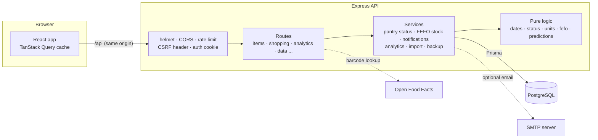

**Request flow (adding an item):** the form validates in the browser → `POST /api/items` → the CSRF header and auth cookie are checked → Zod validates the body again → category and location are checked to belong to the user → duplicate check → item + first batch saved in one transaction → activity logged → the response returns the item with its computed status → the app refreshes the dashboard, lists, charts and alerts. If any step fails, nothing is shown as saved.

**Why status isn't stored:** "expiring soon" depends on today's date in the user's time zone and their warning period, so the server computes it on every read from the stored dates. It can never go stale.

### Project structure
```
server/
  prisma/schema.prisma          data model
  prisma/migrations/            SQL migrations
  src/lib/                      pure, unit-tested logic (dates, status, units, FEFO, predictions, CSV, recipes)
  src/services/                 business logic (pantry views, stock changes, notifications, analytics, import, backup, demo)
  src/routes/                   HTTP endpoints
  src/middleware/               auth, CSRF, error handling
  tests/                        unit + integration tests
client/
  src/pages/                    one file per screen
  src/components/               UI kit, item form, stock dialogs, charts, layout
  src/lib/                      API client, formatting, hooks, types
  e2e/                          Playwright browser tests
```

---

## Data model

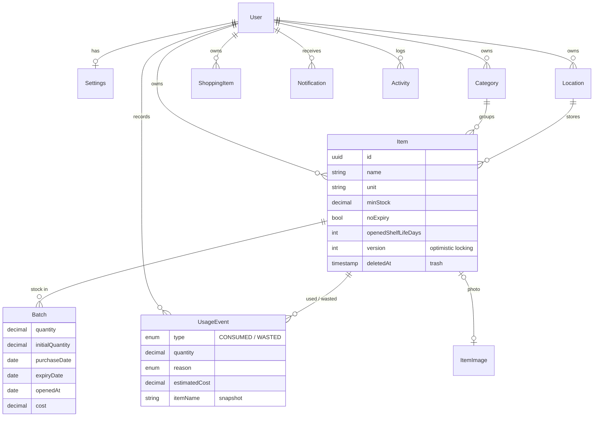
- **Stock = sum of batch quantities.** Quantities are `DECIMAL(12,3)` and calculated in integer thousandths, so `0.1 + 0.2` is exactly `0.3`.
- **Dates are `DATE` columns** (calendar days, not timestamps), compared with "today" in the user's time zone.
- Usage records keep a **snapshot of the item name**, so history survives deleting the item.
- Images are stored **in the database** so they survive redeploys on hosts with temporary disks.

---

## API overview

All routes are under `/api`. Everything except `auth/*`, `health` and `meta` requires sign-in, and every query is filtered by the signed-in user. State-changing requests must send `X-Requested-With: SmartPantry`.

| Area | Endpoints |
|---|---|
| Auth | `POST auth/register` · `auth/login` · `auth/logout` · `auth/forgot-password` · `auth/reset-password` · `auth/change-password` · `GET/PATCH auth/me` |
| Items | `GET items` (search, filter, sort, page) · `POST items` · `GET/PATCH/DELETE items/:id` · `GET items/trash` · `POST items/:id/restore` · `DELETE items/:id/permanent` · `GET items/:id/history` · `GET items/calendar?month=` |
| Stock | `POST items/:id/batches` (restock) · `PATCH/DELETE items/:id/batches/:batchId` · `POST items/:id/batches/:batchId/open` · `POST items/:id/consume` · `POST items/:id/discard` · `POST items/:id/discard-expired` |
| Organise | `GET/POST categories` · `PATCH/DELETE categories/:id?reassignTo=` · same for `locations` |
| Shopping | `GET/POST shopping` · `POST shopping/from-low-stock` · `PATCH/DELETE shopping/:id` · `POST shopping/:id/purchase` · `DELETE shopping/purchased` |
| Insights | `GET dashboard` · `GET analytics?from&to` · `GET predictions` · `GET usage` |
| Rewards | `GET gamification` (points, level, streaks, badges, weekly challenge) · `POST gamification/seen` |
| Recipes | `GET recipes/ingredients` · `GET recipes/explore?ingredient=` · `GET recipes/library/:id?servings=` · `GET recipes/online/:id` · `GET recipes/suggestions` · `POST recipes/cooked` |
| Alerts | `GET notifications` · `GET notifications/unread-count` · `POST notifications/:id/read` · `POST notifications/read-all` · `DELETE notifications/:id` · `GET activity` |
| Data | `GET data/export/items.csv` · `shopping.csv` · `usage.csv` · `analytics.csv` · `report.pdf` · `GET data/import/template.csv` · `POST data/import/items` · `GET data/backup.json` · `POST data/restore` |
| Extras | `GET barcode/:code` · `POST/GET/DELETE images` · `POST/DELETE demo` · `GET/PUT settings` · `GET health` |

Errors always look like `{ "error": { "message", "code", "details": { "fields": { ... } } } }`, so the UI can show each message next to the right field.

---

## Design decisions worth explaining

- **A missing date is never "safe".** Items without a date show as *Date missing* and need review. Only items the user explicitly marks "no expiry" (salt, sugar) skip the date.
- **The app never claims food is safe to eat.** Statuses describe dates; the UI reminds users to check food, and eating expired stock needs confirmation.
- **Two people editing at once:** each item has a `version`. An edit based on an old version is rejected (409) instead of silently overwriting. Stock changes lock the item's batch rows (`SELECT … FOR UPDATE`) so two simultaneous "use" actions can't oversell.
- **Double-clicks can't create duplicates:** adding an item, buying a shopping-list entry and loading demo data are protected by database locks, so two identical requests arriving together only succeed once (tested by firing them at the same time).
- **Clean-up:** a daily job removes photos that were uploaded but never attached to an item, plus old password-reset links. Each account is capped at 300 photos.
- **Account control:** "Sign out of all devices" (for a lost phone) and "Delete my account" (password and typed confirmation; removes all data). Users can download a backup first.
- **Website security headers:** a strict Content Security Policy (only the app's own scripts can run; only YouTube can be embedded), plus clickjacking, MIME-sniffing and camera/microphone permission headers. They're set in `vercel.json` and `nginx.conf`, and `npm run preview` serves the same headers so they can be tested locally (verified with zero violations).
- **Security:** bcrypt (cost 12), JWT in an httpOnly SameSite cookie (JavaScript can't read it), a custom CSRF header on writes, rate-limited login, timing-safe login responses, image type checked from file bytes, CSV exports escaped against formula injection, and a `tokenVersion` that signs out all old sessions after a password change.
- **Honesty:** emails are only reported as sent when the mail server accepts them; cost figures are labelled estimates and state how many records had no price; forecasts state their method.
- **Never lose data:** delete goes to Trash with Undo; imports and restores preview first and never overwrite; categories in use can't be deleted without moving their items.

---

## Feature status

**Complete and tested:** everything listed under *What it does*.

**Optional, needs configuration**
| Feature | What's needed |
|---|---|
| Password-reset and reminder emails | SMTP credentials in `server/.env` (any provider, e.g. Gmail app password, Brevo, Mailgun). Without them the app works fully and says email is off. |
| Barcode lookup | Internet access to `world.openfoodfacts.org`. If unavailable, the app says so and manual entry still works. |
| Camera barcode scanning | HTTPS (or localhost) and camera permission. Typing the barcode always works. |
| Online recipes & videos | Internet access to `www.themealdb.com` (free, no key). Results are cached for 6 hours. If unreachable, the app says so and the 39 built-in recipes still work. Videos play from YouTube. |
| Read-aloud in the cook-along | A browser with speech synthesis (Chrome, Edge, Safari). Otherwise steps advance after a reading pause. |

| Phone notifications | HTTPS (or localhost) and a browser with Web Push: Chrome, Edge, Firefox, Samsung Internet; on iPhone/iPad (iOS 16.4+) add the site to the Home Screen first. The app explains what to do on browsers that can't. |

**Ideas for future versions (not implemented):** receipt scanning, email verification at sign-up, per-account login lockout (login is limited per network address today), translating recipe steps and chart labels (the interface is translated; recipe text and chart axis labels stay in English).

---

## Notes on how this was built and verified

- Backend: 100 automated tests pass against PostgreSQL 16 (unit tests for dates, status, units, FEFO, forecasts, CSV and recipes; integration tests for every module, including a test that one user cannot read or change another user's data).
- Frontend: 8 Playwright tests pass (desktop and mobile), plus scripted browser walkthroughs (22 pantry steps and 18 recipe steps), with screenshots reviewed in light, dark and mobile layouts.
- The migration SQL (initial schema and the 30 Oct gamification change) was written by hand in Prisma's format because Prisma's migration engine couldn't be downloaded in the build environment. Prisma's own engine verifies it against `schema.prisma` in CI on the first push (the "no drift" step). If that step ever fails, run `npx prisma migrate dev` in `server/` to regenerate it.
- Online recipes couldn't be fetched from the build environment (TheMealDB blocked there). They're covered by tests with a simulated TheMealDB response, but the first real check is when you search on your own machine.
- Docker: the base images couldn't be downloaded in the build environment (Docker Hub blocked), so each Dockerfile's steps were replayed in a clean folder: clean install, build, the API starting in production mode, and the real `nginx.conf` serving the built site with its security headers and proxying `/api` (sign-up and sign-in through the proxy worked).
- Email: reminder emails were sent to a local test mail server and checked (subject, contents, sent once, `FAILED` recorded honestly when the server refuses). Real delivery needs your SMTP details.
- Phone notifications: the server side is tested with a recorder in place of Google/Apple's push services; in a real browser, a push delivered to the service worker shows the right notification. Subscribing needs a real browser with internet.
- Hindi and Kannada were written for this project; have a native speaker review the wording before launch.
